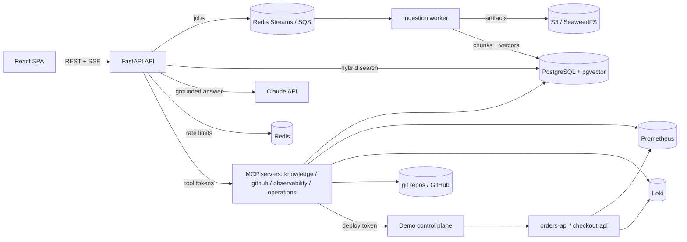

# OpsPilot AI

An engineering-operations copilot. It answers questions from your runbooks and postmortems with citations that
resolve to the exact passage, investigates incidents with an agent that reads metrics, logs, deployments and code
through MCP servers, and can roll back a bad deployment, but only after a different human approves that exact
action.


| Evaluations (recorded runs) | Approvals (two-person, single-use) |
|---|---|
|  |  |

## Status

| Phase | Scope | State |
|---|---|---|
| 0 | Monorepo, Compose stack, schema and migrations, API and frontend shell, CI | done |
| 1 | RAG: ingestion worker, chunking, embeddings, hybrid retrieval, reranking, permissions, grounded generation, golden-set evaluation | done (generation tested with a scripted model only) |
| 2 | MCP servers (knowledge, GitHub, observability, operations), demo environment with real telemetry, approval state machine | done (GitHub code search needs a token, unverified) |
| 3 | Investigation agent on the Claude Agent SDK | built; **not run against the live model** |
| 4 | Approval UI and agent remediation handoff | done |
| 5 | Product UI (10 pages) | done |
| 6 | Cross-service tracing, fault injection, hardening | done |
| 7 | AWS Terraform and OIDC deploy workflow | written and statically validated; **never applied** |
| 8 | Fresh-clone verification, evaluation, polish | done |

## What has been verified, and what has not

**Verified against real services:**
- **Ingestion, retrieval and permissions:** tested against real Postgres, Redis and S3.
- **MCP servers:** exercised over HTTP, including by the independent MCP Inspector CLI through a full live
  incident: detection, logs, commit diff, runbook lookup, rollback request, refusal before approval, human
  approval, a single execution, refusal on replay, and recovery in Prometheus.
- **Approval UI:** tested end to end with Playwright.
- **Tracing:** cross-service traces confirmed in Jaeger.
- **Fresh clone:** `cp .env.example .env && docker compose --profile demo up --build`, followed by all
  E2E tests with default security settings.

**Verified with only the model replaced:** the agent runs on the real Claude Agent SDK and its bundled CLI, against
real MCP servers, approvals and Postgres. A scripted Messages API (`backend/tests/fake_anthropic.py`) stands in
for Claude. These tests prove the orchestration:

- tool permissions per role;
- turn, cost, time and tool-call budgets;
- the approval handoff;
- resume from Postgres after all local state is deleted;
- cancellation;
- that a model which *obeys* an injected instruction still cannot change anything.

**Not verified:** answer and investigation *quality* with the live Claude API (no key was available), GitHub code
search (no token), and the AWS deployment (no account). Nothing here claims otherwise.

## What it does

- **Knowledge and RAG:**
  - Markdown, text and PDF ingestion in a separate worker, with versioning, duplicate detection and incremental
    re-embedding.
  - Exact-offset, structure-aware chunks.
  - Hybrid retrieval (pgvector HNSW and Postgres full-text, fused with RRF), then cross-encoder reranking.
  - Tenant and scope filters applied *inside* the candidate SQL.
  - A calibrated evidence-sufficiency gate.
  - Claude answers whose citations are indices into the retrieved passages, verified before display.
- **MCP servers** (official SDK, Streamable HTTP):
  - Knowledge search and reading.
  - GitHub (REST API, or local git for the deterministic demo repositories).
  - Observability (Prometheus and Loki through fixed query templates).
  - Operations (deployment state, rollback eligibility, approval-gated rollback).
  - Every call carries a short-lived Ed25519 token minted for the signed-in user. See
    [docs/MCP_TOOLS.md](docs/MCP_TOOLS.md).
- **Investigation agent** (Claude Agent SDK):
  - No built-in tools; MCP tools filtered by role.
  - Budgets, cancellation, and transcripts in Postgres so a session can resume on any worker.
  - Streamed timeline of tool calls and results.
  - A structured incident report whose evidence is checked against tool calls that actually succeeded.
  - Qualitative confidence only, never a made-up number.
- **Safe remediation:**
  - Approvals bind the requester, exact argument hash, target state snapshot, expiry and a one-time execution ID.
  - The approver must be someone else, and there is no approve tool.
  - Execution re-checks the live target and deploys with compare-and-swap.
  - It acts only on the isolated demo environment.
- **Demo environment:**
  - Orders and Checkout services whose behaviour follows the deployed version, so a bad release really exhausts
    the connection pool.
  - Steady traffic, Prometheus and Loki, and a git history with reproducible SHAs.
  - Scenario triggers, resettable from the UI.
- **Observability:**
  - JSON logs with redaction.
  - Prometheus metrics.
  - OpenTelemetry traces from API to MCP tool to retrieval.
  - Per-query and per-turn token usage and cost estimates from provider-reported usage.
  - Audit log of security-relevant actions.
- **UI:** Overview, Investigate, Ask, Incidents, Approvals, Knowledge Base, Integrations, Evaluations, Settings,
  Activity. Dark by default, with a light theme.
- **Deployment:**
  - Terraform for AWS: ECS Fargate, RDS PostgreSQL 17, ElastiCache, S3, SQS, KMS, WAF, alarms.
  - A GitHub OIDC deploy workflow with a migration gate and automatic rollback. See [DEPLOYMENT.md](DEPLOYMENT.md).

## Measured retrieval quality

From `python -m opspilot.evaluation.rag_eval` on the 35-question golden set
([`evals/golden/rag_golden.jsonl`](evals/golden/rag_golden.jsonl)) over the 8-document demo corpus,
K=5. Full results and methodology are in [EVALUATION.md](EVALUATION.md).

| Configuration | Recall@5 | MRR | nDCG@5 | p50 latency* |
|---|---|---|---|---|
| Dense (bge-small-en-v1.5) | 0.964 | 0.898 | 0.891 | 16 ms |
| Lexical (Postgres FTS) | 0.881 | 0.746 | 0.759 | 7 ms |
| Hybrid (RRF) | 0.946 | 0.863 | 0.872 | 16 ms |
| Hybrid + cross-encoder rerank (top 20) | 0.982 | 0.946 | 0.938 | 198 ms |

\*In-process on one developer laptop (Apple Silicon), not a production benchmark.

On this small, clean corpus, **plain hybrid retrieval is worse than dense alone**. Reranking is what
improves quality, and with reranking, hybrid and dense tie. Hybrid stays the default because exact
identifiers (alert names, error codes, metric names) are common in operations text, but this golden
set doesn't yet demonstrate that benefit. The corpus is small (8 documents, 4 held-out unanswerable
questions), so treat these numbers as a regression baseline, not a general claim.

## Architecture



See [ARCHITECTURE.md](ARCHITECTURE.md) for module boundaries and data flow, and
[DESIGN_DECISIONS.md](DESIGN_DECISIONS.md) for the trade-offs.

## Quick start

Requirements: Docker with Compose v2 and about 6 GB of memory for Docker (the full stack runs 18 containers,
including two ONNX models and steady synthetic traffic), and network access on the first run
to download the embedding and reranker models (about 150 MB).

```bash
cp .env.example .env            # optionally set ANTHROPIC_API_KEY
docker compose --profile demo up --build
```

- UI: http://localhost:8080. API docs: http://localhost:8000/api/docs
- The `seed` service creates a **Demo Workspace** with fictional documentation (labelled "demo data"
  in the UI) and four users, all with the password from `OPSPILOT_DEMO_PASSWORD`:
  `admin@opspilot.demo`, `sre@opspilot.demo` (can read the `sre-restricted` scope),
  `engineer@opspilot.demo`, `viewer@opspilot.demo`.
- Without `--profile demo`, create users with
  `docker compose run --rm api python -m opspilot.cli create-user --email you@corp.example --name You --workspace acme --role admin --scopes general`.

### Example: grounded answers

Sign in as `engineer@opspilot.demo` and ask *"What is the documented procedure for recovering the
checkout service after a database connection failure?"*. The retrieval panel shows the Checkout
runbook's *Recovery procedure* section ranked first (dense rank 1, lexical rank 2, rerank score 6.65).
With an API key configured, the answer streams with citation markers that open the exact passage.
Ask *"What is the name of the break-glass database administrator account?"* as the engineer and the
system abstains: the answer exists only in an `sre-restricted` document. Ask the same question as
`sre@opspilot.demo` and it is answered.

### Example: an incident

As `admin@opspilot.demo`, open **Integrations → Demo environment** and trigger `orders-bad-deploy`. Within about
30 s, orders-api returns HTTP 500 `PoolTimeoutError` for about a quarter of requests. Then:

- **With a model key:** ask **Investigate** *"Investigate why the orders API started returning HTTP 500 errors
  after the latest deployment"*. Then ask it to roll back, approve as `sre@opspilot.demo` in **Approvals**, and
  tell the agent the rollback was approved.
- **Without a key:** drive the same MCP tools with the MCP Inspector CLI; see
  [docs/INCIDENT_DEMO.md](docs/INCIDENT_DEMO.md).

## Development

```bash
# backend
cd backend && uv sync && uv run pytest        # needs Docker for Postgres/Redis testcontainers
uv run ruff check src tests && uv run mypy
# frontend
cd frontend && npm ci && npm run lint && npm run typecheck && npm test
npx playwright test                           # against a running stack
# evaluation (needs a migrated Postgres; see EVALUATION.md)
cd backend && uv run python -m opspilot.evaluation.rag_eval --compare-baseline
```

Latest local verification (Phase 8):

- **Backend:** 109 tests pass against real Postgres (pgvector) and Redis, with MCP servers over real HTTP and the
  agent on the real Claude Agent SDK and CLI with a scripted model. Ruff and mypy `--strict` are clean.
- **Frontend:** 17 unit tests pass; eslint (type-aware) and `tsc` are clean.
- **End to end:** 9 Playwright tests pass against a stack started from a **fresh clone** with exactly
  `cp .env.example .env && docker compose --profile demo up --build`, with default security settings.
- **Retrieval:** the regression gate reports no regression against the committed baseline.
- **Infrastructure:** Terraform passes `fmt` and `validate`, and Checkov reports 0 failures.
- **CI:** the GitHub Actions workflows pass actionlint, but have not yet run on GitHub.

## Security model (summary)

- **Isolation:** tenant and scope checks are SQL predicates on every query and citation lookup.
- **MCP identity:** comes only from signed, audience-bound, 120-second tool tokens. Servers re-check membership,
  and the model can't supply identity.
- **Privileged actions:** go through a database state machine, not a prompt. Every refusal is audited.
- **Untrusted content:** retrieved documents, logs and repository content are treated as data. The demo traffic
  deliberately plants an injection attempt in logs, and tests confirm it can't cause a mutation.
- **AWS:** per-service IAM roles, customer-managed KMS encryption, WAF, and secrets kept out of Terraform state.

Details: [SECURITY.md](SECURITY.md), [THREAT_MODEL.md](THREAT_MODEL.md).

## Known limitations

- Answer generation and agent investigations have not been run against the live Claude API (see above).
- The agent's own tool calls (made by its CLI subprocess) are not yet linked into the turn's trace.
- Access tokens are bearer tokens kept in `sessionStorage`; there are no refresh tokens or server-side
  revocation yet.
- Cross-encoder reranking is CPU-bound: about 200 ms in-process for 20 candidates, and noticeably
  slower inside Docker Desktop on macOS (about 1.2–1.9 s observed for 40 candidates before the depth
  was reduced).
- The golden set is small and was written by the same author as the corpus.
- No OCR; scanned PDFs are rejected with a clear error.
- GitHub repository *ingestion* into the knowledge base is not built. The AWS deployment is written but has
  never been applied. GitHub code search via the REST provider needs a token and is unverified.
- Health classification uses 5-minute windows, so it lags recovery by up to 5 minutes.
- On a 16 GB laptop, running the full stack *and* the backend test suite at the same time can push the machine
  into heavy swapping. Stop the stack (`docker compose stop`) or point tests at it (see CONTRIBUTING.md).

## Repository layout

```
backend/    FastAPI API, ingestion worker, RAG pipeline, MCP servers, agent worker, CLI, migrations, tests
frontend/   React + TypeScript SPA, Vitest unit tests, Playwright E2E
demo/       demo environment: control plane, orders/checkout services, traffic, git history, docs corpus
evals/      golden dataset and committed retrieval baseline
infra/      local config (Prometheus, S3 gateway) and AWS Terraform (modules, stack, dev/prod envs)
docs/       MCP tool reference, incident demo guide, API notes, screenshots
```

## License

MIT; see [LICENSE](LICENSE).
