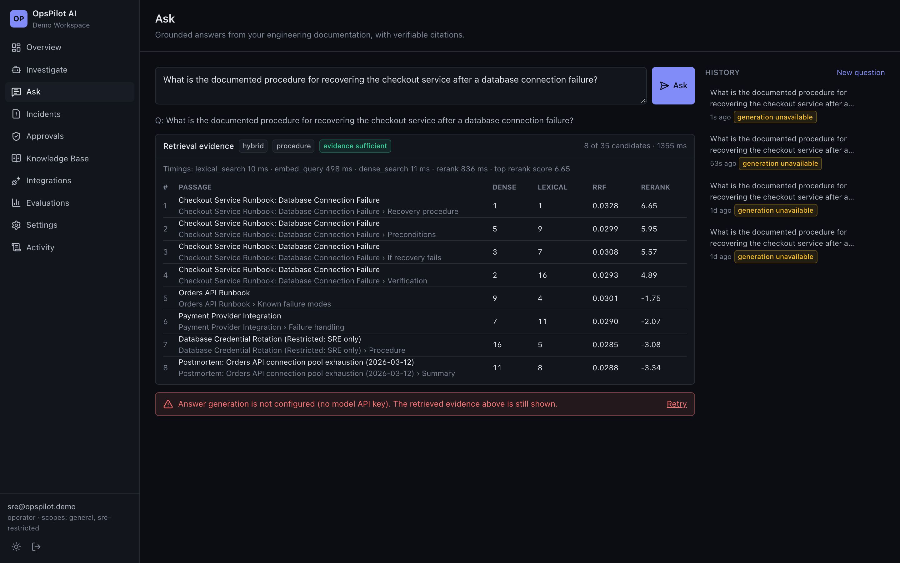
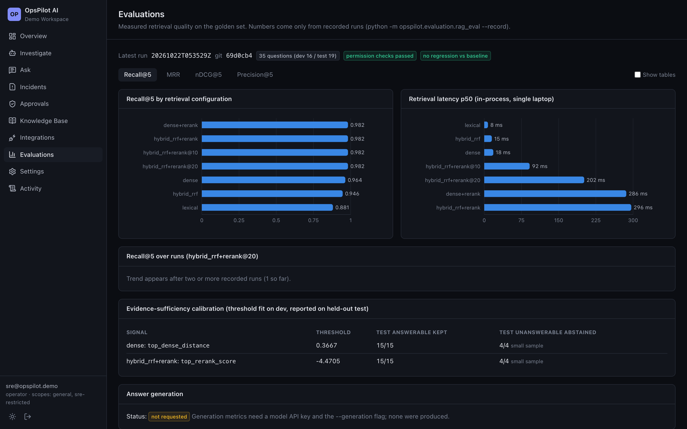
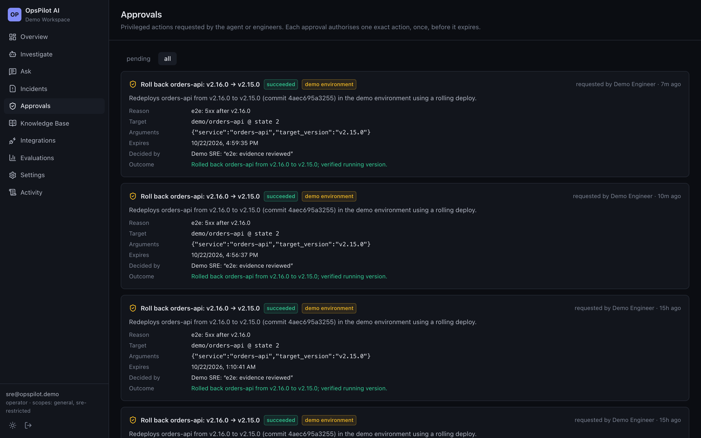
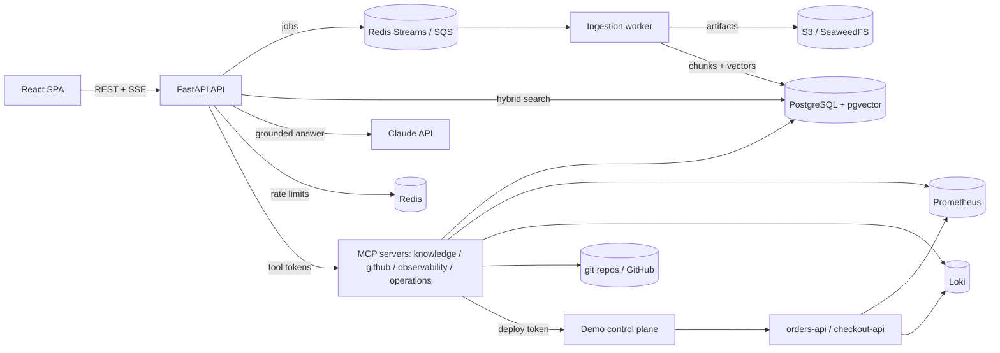

# OpsPilot AI

An engineering-operations copilot: upload runbooks, architecture notes and postmortems, then ask
questions and get answers grounded in that documentation, with citations that resolve to the exact
passage the answer relied on. The roadmap adds MCP-based incident investigation and human-approved
remediation on top of this foundation (see [Status](#status)).



| Evaluations (recorded runs) | Approvals (two-person, single-use) |
|---|---|
|  |  |

## Status

This repository is being built in vertical slices. Only what is listed as **done** has been
implemented and verified; nothing else should be assumed to exist.

| Phase | Scope | State |
|---|---|---|
| 0 | Monorepo, Docker Compose stack, Postgres/pgvector schema + migrations, API + frontend shell, CI | **done** |
| 1 | Production RAG: ingestion worker, chunking, embeddings, hybrid retrieval, reranking, permissions, grounded generation with verifiable citations, golden-set evaluation | **done** (generation verified only against a scripted test double, see below) |
| 2 | MCP servers (knowledge, GitHub, observability, operations), demo environment with real telemetry, approval state machine | **done**; GitHub code search unverified (needs a token) |
| 3 | Claude Agent SDK investigation agent (sessions, streaming, budgets, structured reports) | **built; not verified against the live model** (no API key) |
| 4 | Approval UI and agent-driven remediation handoff | **done** (UI verified end to end with a human approver) |
| 5 | Full product UI | **done**: Overview, Investigate, Ask, Incidents, Approvals, Knowledge Base, Integrations, Evaluations, Settings, Activity |
| 6 | Observability and hardening: cross-service tracing (verified in Jaeger), fault injection, Argon2 off the event loop, per-test hard timeouts | **done** |
| 7–8 | AWS/Terraform deployment, final evaluation | not started |

**Phase 2 verification:** the four MCP servers were exercised by the official MCP Inspector CLI (an independent
client) against the live stack through a complete incident: detection, logs, commit diff, runbook retrieval,
rollback request, refusal before approval, human approval, single execution, refusal on replay, and recovery in
Prometheus. See [docs/INCIDENT_DEMO.md](docs/INCIDENT_DEMO.md) and [docs/MCP_TOOLS.md](docs/MCP_TOOLS.md).

**Phase 3 verification (without a model):** the agent runs on the real Claude Agent SDK and its bundled CLI, against
the real MCP servers, approvals and Postgres. Tests replace only the model with a scripted Messages API test double
(`backend/tests/fake_anthropic.py`). This verifies orchestration: tool permissions, budgets, approval handoff,
resume from Postgres after local state is deleted, cancellation, and refusal of an injection-obeying model. It does
not verify investigation quality, which needs a live model and has not been measured.

**Unverified external integration:** no Anthropic API key was available while building, so answer
generation has been exercised only through a scripted test double of the SDK's streaming interface
(request shape, citation resolution, usage/cost accounting, abstention, SSE). Retrieval, ingestion,
permissions and the UI are verified end-to-end against real services. Set `ANTHROPIC_API_KEY` to
enable generation; without it the UI shows retrieved evidence and says generation is unavailable.

## What works today

- **Ingestion** of Markdown, plain text and PDF: type sniffing (extension and magic bytes must agree),
  size and page limits, SHA-256 content hashing, per-document versioning, duplicate detection,
  re-index, delete with index and artifact cleanup. Runs in a separate worker process fed by Redis
  Streams (SQS adapter for AWS), with idempotent job claims, retries with exponential backoff and full
  jitter, a dead-letter stream, stale-lease recovery and durable job status shown in the UI.
- **Incremental indexing:** a re-uploaded document only re-embeds passages whose text or heading
  context changed (verified in tests: editing one section re-embeds exactly one passage).
- **Structure-aware chunking** that keeps each passage's heading path and *exact* character offsets
  into the normalised source (asserted for every chunk of the corpus in tests).
- **Hybrid retrieval:** pgvector HNSW cosine search + PostgreSQL full-text search, fused with
  Reciprocal Rank Fusion, reranked by a local cross-encoder, then budgeted (token budget, duplicate
  suppression, per-document cap). Tenant and access-scope predicates run *inside* each candidate SQL
  query, before ranking and `LIMIT`.
- **Evidence-sufficiency gate:** if the top reranked passage scores below a threshold calibrated on
  the golden set's dev split, the system abstains without calling the model.
- **Grounded generation** (Claude via the official `anthropic` SDK): passages are sent as
  `search_result` blocks with citations enabled. Each returned citation's index is resolved to a chunk
  we retrieved; citations that don't resolve, or whose quoted text isn't in that chunk, are discarded
  and counted. Streamed to the browser over SSE, with cancellation, persisted history, provider-reported
  token usage and cost from configured prices.
- **Auth:** Argon2id passwords, short-lived signed access tokens, server-side role and scope
  resolution on every request, rate-limited login, audit log.
- **UI:** Overview, Ask (streaming answers, inline citation markers, passage preview with the cited
  text highlighted, retrieval diagnostics), Knowledge Base (upload, live ingestion status, versions,
  passages, re-index, delete), Activity (audit log). Dark theme by default, with a light theme option.

## Measured retrieval quality

From `python -m opspilot.evaluation.rag_eval` on the 35-question golden set
([`evals/golden/rag_golden.jsonl`](evals/golden/rag_golden.jsonl)) over the 8-document demo corpus,
K=5. Full results and methodology are in [EVALUATION.md](EVALUATION.md).

| Configuration | Recall@5 | MRR | nDCG@5 | p50 latency* |
|---|---|---|---|---|
| Dense (bge-small-en-v1.5) | 0.964 | 0.898 | 0.891 | 16 ms |
| Lexical (Postgres FTS) | 0.881 | 0.746 | 0.759 | 7 ms |
| Hybrid (RRF) | 0.946 | 0.863 | 0.872 | 16 ms |
| Hybrid + cross-encoder rerank (top 20) | 0.982 | 0.946 | 0.938 | 198 ms |

\*In-process on one developer laptop (Apple Silicon), not a production benchmark.

On this small, clean corpus, **plain hybrid retrieval is worse than dense alone**. Reranking is what
improves quality, and with reranking, hybrid and dense tie. Hybrid stays the default because exact
identifiers (alert names, error codes, metric names) are common in operations text, but this golden
set doesn't yet demonstrate that benefit. The corpus is small (8 documents, 4 held-out unanswerable
questions), so treat these numbers as a regression baseline, not a general claim.

## Architecture



See [ARCHITECTURE.md](ARCHITECTURE.md) for module boundaries and data flow, and
[DESIGN_DECISIONS.md](DESIGN_DECISIONS.md) for the trade-offs.

## Quick start

Requirements: Docker with Compose v2 and about 6 GB of memory for Docker (the full stack runs 18 containers,
including two ONNX models and steady synthetic traffic), and network access on the first run
to download the embedding and reranker models (about 150 MB).

```bash
cp .env.example .env            # optionally set ANTHROPIC_API_KEY
docker compose --profile demo up --build
```

- UI: http://localhost:8080. API docs: http://localhost:8000/api/docs
- The `seed` service creates a **Demo Workspace** with fictional documentation (labelled "demo data"
  in the UI) and four users, all with the password from `OPSPILOT_DEMO_PASSWORD`:
  `admin@opspilot.demo`, `sre@opspilot.demo` (can read the `sre-restricted` scope),
  `engineer@opspilot.demo`, `viewer@opspilot.demo`.
- Without `--profile demo`, create users with
  `docker compose run --rm api python -m opspilot.cli create-user --email you@corp.example --name You --workspace acme --role admin --scopes general`.

### Example

Sign in as `engineer@opspilot.demo` and ask *"What is the documented procedure for recovering the
checkout service after a database connection failure?"*. The retrieval panel shows the Checkout
runbook's *Recovery procedure* section ranked first (dense rank 1, lexical rank 2, rerank score 6.65).
With an API key configured, the answer streams with citation markers that open the exact passage.
Ask *"What is the name of the break-glass database administrator account?"* as the engineer and the
system abstains: the answer exists only in an `sre-restricted` document. Ask the same question as
`sre@opspilot.demo` and it is answered.

## Development

```bash
# backend
cd backend && uv sync && uv run pytest        # needs Docker for Postgres/Redis testcontainers
uv run ruff check src tests && uv run mypy
# frontend
cd frontend && npm ci && npm run lint && npm run typecheck && npm test
npx playwright test                           # against a running stack
# evaluation (needs a migrated Postgres; see EVALUATION.md)
cd backend && uv run python -m opspilot.evaluation.rag_eval --compare-baseline
```

Latest local verification (Phase 2): 91 backend tests (unit + integration against real pgvector and Redis),
9 frontend unit tests and 5 Playwright E2E tests against the full Compose stack (desktop and mobile
viewports) all pass; ruff, mypy `--strict`, eslint (type-aware) and `tsc` are clean. The GitHub
Actions workflow in `.github/workflows/ci.yml` has not yet run on GitHub.

## Security model (summary)

Tenant isolation is enforced in SQL on every query, not in prompts. Users only see documents in
access scopes their membership grants, and citations resolve through the same predicate, so a citation
can't reveal an inaccessible passage. Retrieved text is treated as untrusted data: the system prompt
says so, but the controls that matter (what is retrieved, what can be cited) don't depend on the model
obeying it. Details: [SECURITY.md](SECURITY.md), [THREAT_MODEL.md](THREAT_MODEL.md).

## Known limitations

- Answer generation has not been verified against the live Claude API (see Status).
- Access tokens are bearer tokens kept in `sessionStorage`; there are no refresh tokens or server-side
  revocation yet.
- Cross-encoder reranking is CPU-bound: about 200 ms in-process for 20 candidates, and noticeably
  slower inside Docker Desktop on macOS (about 1.2–1.9 s observed for 40 candidates before the depth
  was reduced).
- The golden set is small and was written by the same author as the corpus.
- No OCR; scanned PDFs are rejected with a clear error.
- GitHub repository *ingestion* into the knowledge base, the agent, the approval UI, Terraform and deployment are
  not built yet. GitHub code search via the REST provider needs a token and is unverified.
- Health classification uses 5-minute windows, so it lags recovery by up to 5 minutes.
- On a 16 GB laptop, running the full stack *and* the backend test suite at the same time can push the machine
  into heavy swapping. Stop the stack (`docker compose stop`) or point tests at it (see CONTRIBUTING.md).

## Repository layout

```
backend/    FastAPI app, ingestion worker, RAG pipeline, CLI, Alembic migrations, tests
frontend/   React + TypeScript SPA, Vitest unit tests, Playwright E2E
demo/       demo environment: control plane, orders/checkout services, traffic, git history, docs corpus
evals/      golden dataset, committed baseline, run artifacts (git-ignored)
infra/      local infrastructure configuration
docs/       screenshots and API notes
```

## License

MIT; see [LICENSE](LICENSE).
